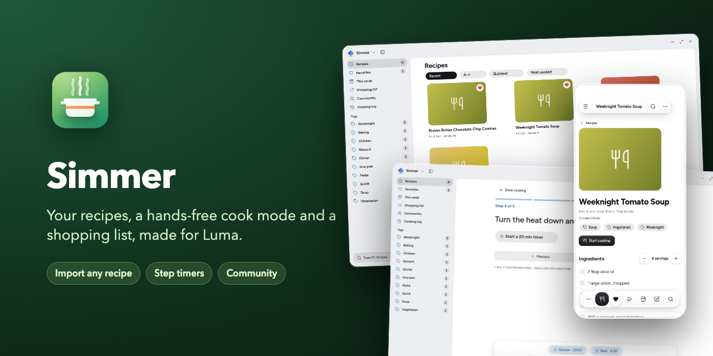
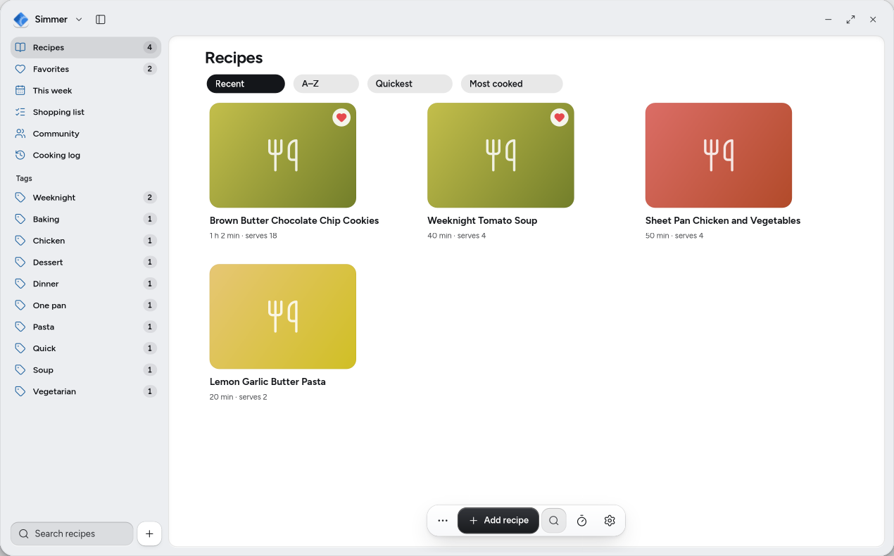
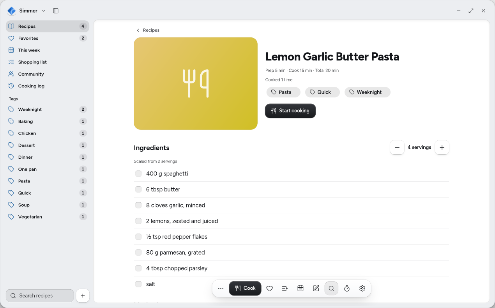
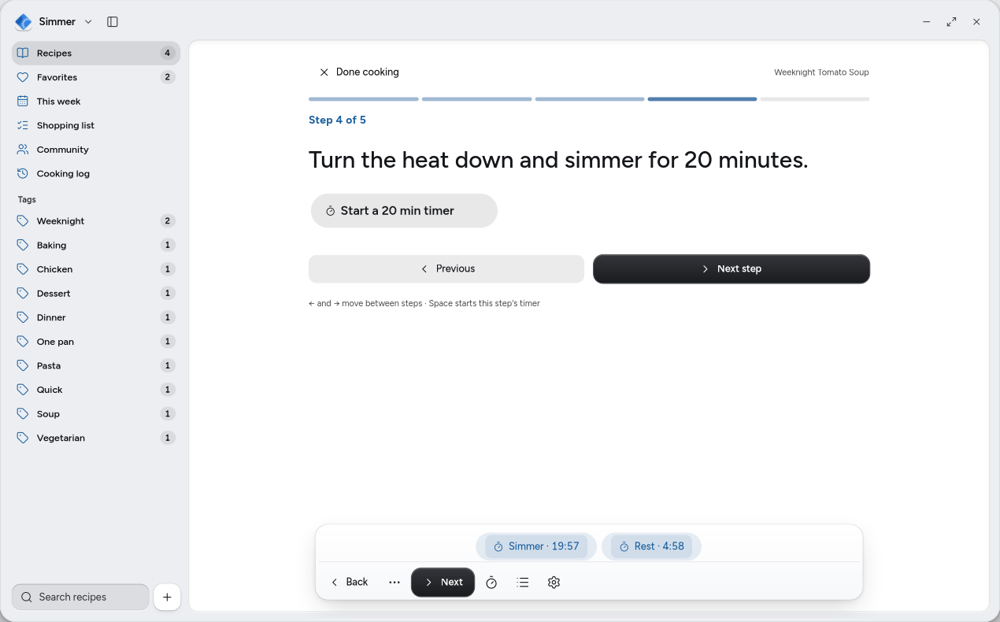
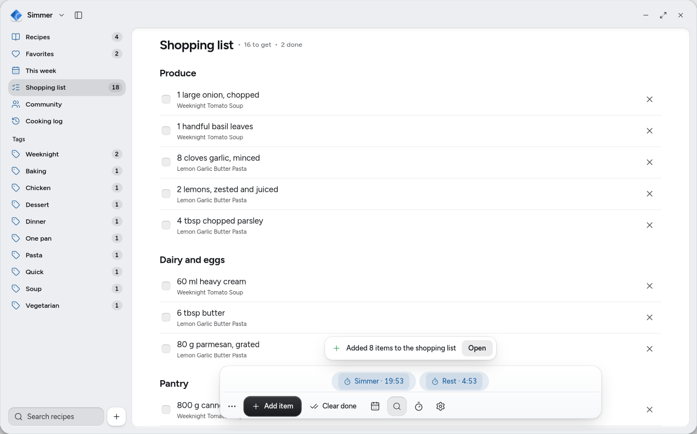
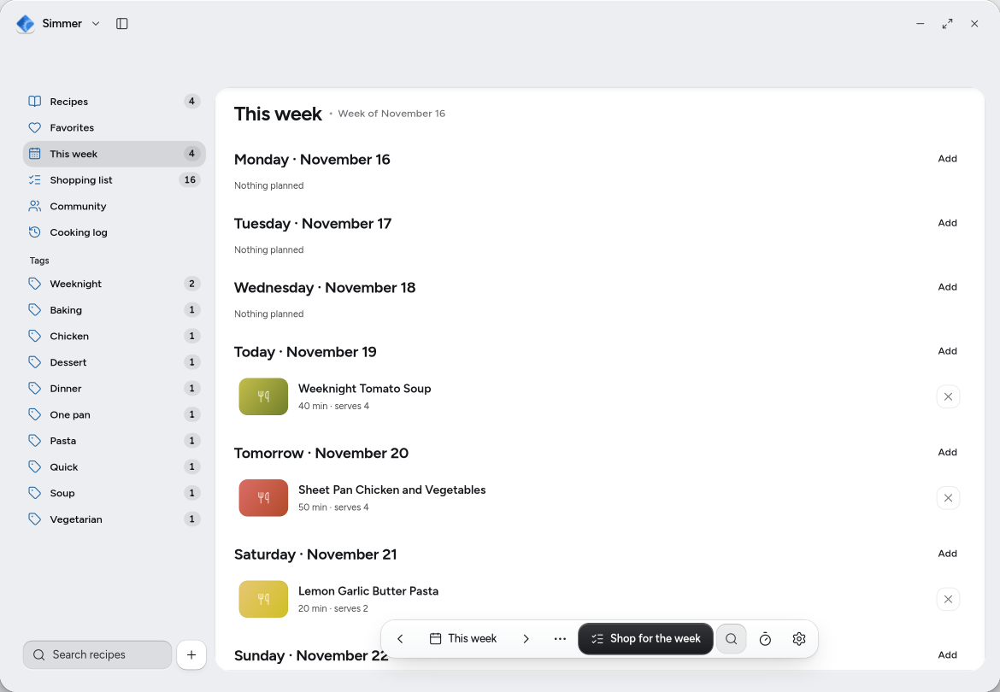
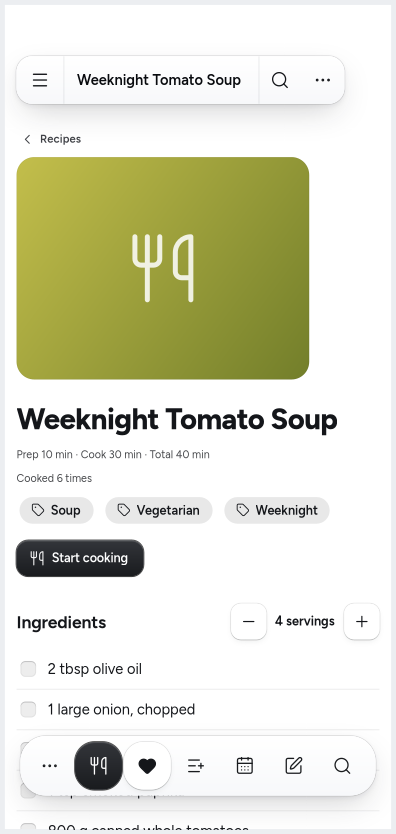
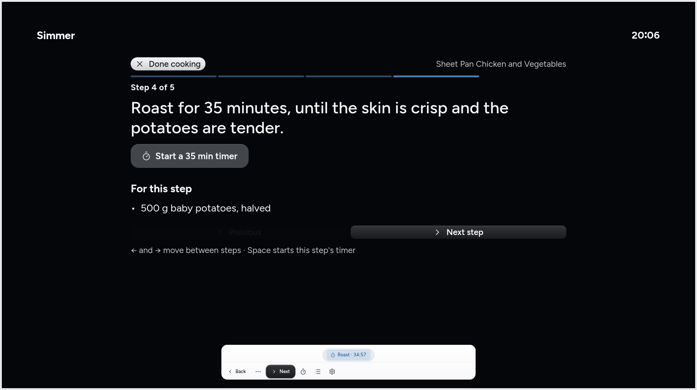

<p align="center">
  
</p>

<p align="center">
  <a href="https://github.com/chartmann1590/simmer/actions/workflows/tests.yml"></a>
  <a href="LICENSE"></a>
  <a href="https://simplyluma.com"></a>
  
</p>

# Simmer

**Recipes and cooking, made for [Luma](https://simplyluma.com).** Simmer is a recipe box and kitchen companion:

- **Collect recipes:** import one from almost any cooking site with a link, paste one from a message, or write
  your own.
- **Cook:** one big step at a time, with the timers already in the steps.
- **Shop:** a list sorted by aisle that ticks off as you go.

Built with LumaUI, it fits a computer, a tablet propped on the counter, a phone and the kitchen TV.

<table>
  <tr>
    <td width="50%"></td>
    <td width="50%"></td>
  </tr>
  <tr>
    <td width="50%"></td>
    <td width="50%"></td>
  </tr>
</table>

### On every Luma device

<table>
  <tr>
    <th>Tablet</th><th>Phone</th>
  </tr>
  <tr>
    <td width="70%"></td>
    <td width="30%" align="center"></td>
  </tr>
  <tr>
    <th colspan="2">TV</th>
  </tr>
  <tr>
    <td colspan="2"></td>
  </tr>
</table>

## Features

- **Import from a link.** Simmer reads the recipe a site publishes for search engines (schema.org): ingredients,
  steps, times, servings and the picture, without the ads and the life story.
- **Paste or write.** Paste from a message or a note, and it finds the ingredients and the steps. Or write your
  own, with section headings.
- **Cook mode.** One step at a time in large type, with the screen kept on.
  - It shows the ingredients that step uses.
  - <kbd>←</kbd> and <kbd>→</kbd> (or the remote) move between steps; <kbd>Space</kbd> starts the step's timer.
  - On a TV, the step fills the screen.
- **Timers from the steps.** "Simmer for 20 minutes" becomes a button, and several timers run at once in the bar.
  - They ring out loud and send a notification if you're in another app.
  - They keep running with the window closed.
- **Scale** to the number of people you're feeding, with amounts written the way cooks write them ("1 ½ cups", not
  "1.5 cups").
- **Shopping list.** Add a recipe's ingredients in one tap. They're sorted by aisle (produce, dairy, pantry…) and
  tick off as you shop.
- **Favorites, tags and search** by name, ingredient or tag, plus **Surprise me** for when you can't decide.
- **Community.** Browse and save recipes other Simmer cooks shared, and share your own. See below for how it's kept
  safe.
- **Backups** to a file you keep.
- No account, no ads, no tracking ([privacy policy](PRIVACY.md)).

### The community

The community is shared, text-only recipes from people using Simmer. It's built to be safe and to cost nothing to
run:

- **Text only.** No pictures, and links, emails and phone numbers are removed.
- **Checked before anyone sees it.** Each recipe passes a word filter, a check that it's really a recipe, and
  [Llama Guard](https://developers.cloudflare.com/workers-ai/models/llama-guard-3-8b/), an AI safety model. If the
  check can't run, nothing is published.
- **Reports.** Anyone can report a recipe, and three reports from different people hide it at once.
- **Spam limits.** A few shares a day per device.
- **Only your own recipes.** Imported recipes belong to their site, so they can't be shared.
- **Yours to take down.** Remove a recipe you shared at any time. There are no accounts; a display name is optional.

The server is in [`community/`](community/): a Cloudflare Worker with D1 and Workers AI, all on the free tier. Its
rules and tests are there too.

### Simmer Plus

Everything above is free. **Simmer Plus** is an optional purchase that supports development and adds:

- **Meal planner.** Put recipes on days and see the week at a glance.
- **Smart shopping list.** One tap turns the week's plan into a list, with amounts added up across recipes and
  sorted by aisle.
- **Metric and US units.** Switch any recipe between cups and grams, with sensible rounding.
- **Cooking log.** What you cooked and when, your most-made dishes, and the notes you left yourself.

It's a monthly or yearly subscription (the yearly one starts with a free week) or a one-time unlock. You pay through
Stripe in your browser, and the prices are shown in the app. Cancel any time from the same panel. Simmer is open
source: the Plus code is GPL too.

### Updates

The app watches its [GitHub releases](https://github.com/chartmann1590/simmer/releases) and tells you when a new
version is out, with the release notes.

- **Copies installed from Depot** update through Depot, Luma's own updater.
- **Copies from a GitHub download** fetch the bundle for this device and check it against the release's
  `SHA256SUMS`. They then open it in the system installer, which asks you to confirm.

The app never installs anything itself.

## Keyboard

| Keys | Does |
| --- | --- |
| <kbd>Ctrl</kbd>+<kbd>L</kbd> | Import from a link |
| <kbd>Ctrl</kbd>+<kbd>N</kbd> | Write a recipe |
| <kbd>Ctrl</kbd>+<kbd>Shift</kbd>+<kbd>V</kbd> | Paste a recipe |
| <kbd>Ctrl</kbd>+<kbd>F</kbd> | Search recipes |
| <kbd>Ctrl</kbd>+<kbd>T</kbd> | New timer |
| <kbd>←</kbd> · <kbd>→</kbd> in cook mode | Previous · next step |
| <kbd>Space</kbd> in cook mode | Start the step's timer, or stop a ringing one |
| <kbd>Esc</kbd> in cook mode | Leave cook mode |

## Install

Simmer is headed for **Depot**, Luma's app store. Until it's listed, download the bundle for your device from the
[latest release](https://github.com/chartmann1590/simmer/releases/latest): `x86_64` for computers, `aarch64` for
phones and tablets. Or build it yourself.

## Build

You need the Luma SDK on `x86_64` or `aarch64` (on Luma, or any Linux with Flatpak):

```sh
flatpak remote-add --if-not-exists luma https://dl.simplyluma.com/luma.flatpakrepo
flatpak install luma org.projectluma.Platform//44 org.projectluma.Sdk//44
flatpak-builder --user --install --install-deps-from=luma build-dir flatpak/com.charleshartmann.Simmer.json
flatpak run com.charleshartmann.Simmer
```

## Tests

```sh
python3 -m pytest tests/test_core.py tests/test_billing.py tests/test_promo.py tests/test_updates.py
xvfb-run flatpak run --command=python3 org.projectluma.Sdk//44 tests/test_ui.py   # the real app, in the Luma runtime
(cd community && npm test)                  # the community server and its safety rules
luma lint && luma test                      # Luma's app checks
```

## Project layout

```
src/simmer/
  app.py          window, pages, bar, cook mode and everything you do
  ingredients.py  amounts, units, scaling, conversion, aisles (no GTK, unit tested)
  timers.py       times in steps, and running timers (no GTK, unit tested)
  importer.py     schema.org recipes from pages, and pasted text (no GTK, unit tested)
  store.py        the library in SQLite (no GTK, unit tested)
  community.py    the community client (no GTK, unit tested)
  net.py          recipe pages and pictures
  chime.py        the timer's bell
  widgets.py      recipe cards, pictures, check rows
community/        the community server (Cloudflare Worker, D1, Workers AI)
data/             desktop file, AppStream metainfo, icon, TV tile
flatpak/          Flatpak manifests (Depot, and GitHub builds in flatpak/github)
```

## Contributing

Bug reports and ideas are welcome: [open an issue](https://github.com/chartmann1590/simmer/issues/new/choose).
See [CONTRIBUTING.md](CONTRIBUTING.md) before sending a pull request.

## Licence

[GPL-3.0-or-later](LICENSE). Copyright © 2026 Hartmann Studios. The sample recipes were written for Simmer.
